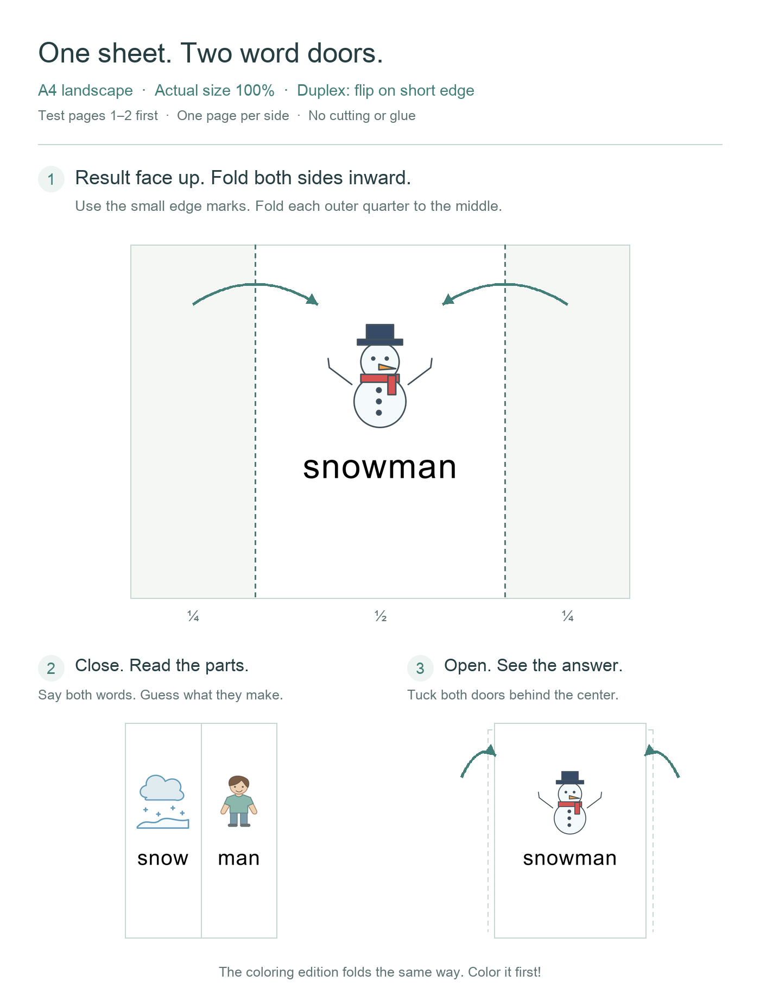

# Word Together

**English** · [简体中文](README.zh-CN.md)

Say two words, clap your hands, and discover what they make. A picture-card game for children and families.

`snow + man → snowman` · `toy + car → toy car`

| Play online | Play on paper |
| --- | --- |
| [Play in English](https://alpskyhere.github.io/word-together/?lang=en) · [使用中文版](https://alpskyhere.github.io/word-together/?lang=zh) | [Color PDF](downloads/word-together-color.pdf) · [Coloring PDF](downloads/word-together-coloring.pdf) |

**141 word groups**: 91 written as one word and 50 written as two words. Choose English or Chinese instructions; learning words and pronunciation are always English.

## Play in three steps

1. **Listen** — click a picture, word or **Listen** to hear it.
2. **Guess** — say the two words, then choose **Clap & reveal**.
3. **Keep going** — choose **Next group**, or **Show the parts** to try the same group again.

<details>
<summary>More ways to play: choose, shuffle, review and celebrate</summary>

| To… | Use… |
| --- | --- |
| Find a group | **Choose words**: filter by one word / two words, or search in English or Chinese. |
| Change the order | Suggested order, A–Z, shortest first, or shuffled order. Each **Shuffle** creates a different order; **Next group** has no repeats in a full pass through the selection. |
| Practise again later | **Practice later**, then **Choose words → Review list**. |
| Adjust sound and rewards | **Settings**: automatic reading, celebrations and sound. Celebrations and sound are on by default; reveal 10 different groups for a reward. |

For combinations such as `hot dog` or `butterfly`, open **Word notes** to explore their meaning.

</details>

## Print and fold

Both PDFs contain all **141 groups**, matching the website: **282 PDF pages = 141 double-sided sheets**. The coloring edition has black outlines for children to color. No cutting or glue is needed.

1. **Print:** A4 landscape · actual size 100% · one page per side · **duplex, flip on short edge**.
2. **Test first:** print pages **1–2**. Each odd/even page pair makes one card; pages 1–20 make ten cards. Do not use booklet mode.
3. **Fold:** result face up, fold each outer quarter inward at the edge marks. Close to read the parts; open and tuck the doors behind the center to reveal the result.



For color words such as `blue`, name the color before coloring.

## Good to know

- **Progress:** saved only in this browser, not uploaded or synced across devices. Clearing browser data removes it. “Revealed” means seen, not mastered.
- **Learning:** this game explores word parts and meanings. It can accompany phonics practice; it is not a complete phonics course.
- **Sound:** pronunciation uses browser/system voices. If you hear nothing, check the volume and try **Listen**.

## Feedback

[Suggest an improvement](https://github.com/alpskyhere/word-together/issues/new) · [Read existing feedback](https://github.com/alpskyhere/word-together/issues)

A GitHub account is required; **all posts are public**. Please leave out email addresses, children's names and other personal information. The website's **Feedback** button includes the current word group and website version in the draft.

<details>
<summary>Open in a new tab, use offline, or run tests</summary>

To keep GitHub open, ⌘-click (Mac) or Ctrl-click (Windows/Linux) a play link. On a phone, long-press it and choose a new tab.

For offline use, download the repository and open `index.html`. The `downloads` folder contains both PDFs. Speech availability depends on the browser and installed voices.

Tests require Python 3 and Node.js, with no third-party packages:

```sh
python3 test_site.py
node test_app.cjs
```

</details>

Website updated (California time): **11/06/2026 21:09 PST (UTC-08:00)** · [Release information](release.json)
