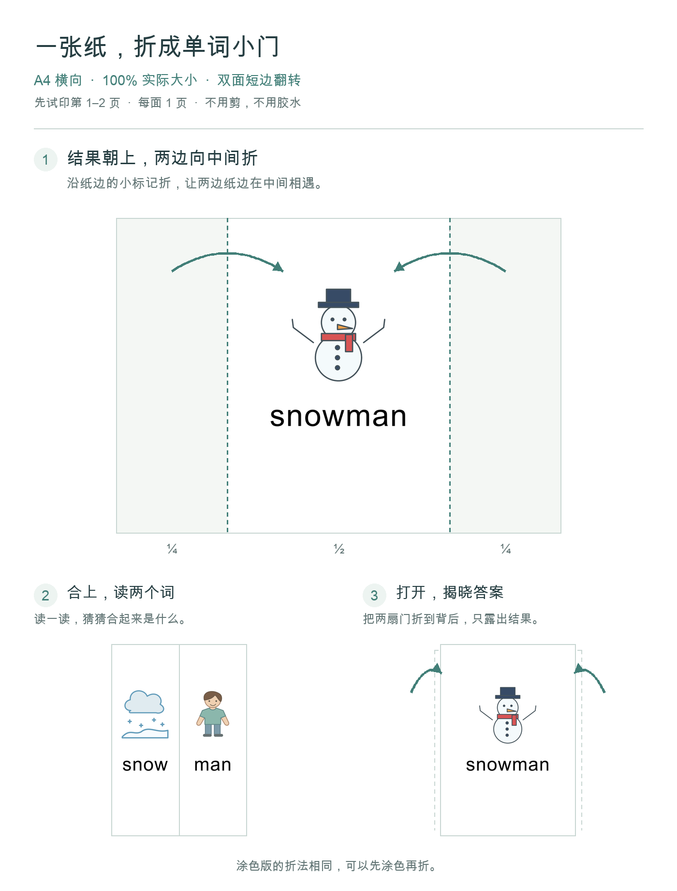

# Word Together · 单词合体

[English](README.md) · **简体中文**

左手一个词，右手一个词，拍手看看合起来是什么。给孩子和家长一起玩的英语图片卡片。

`snow + man → snowman` · `toy + car → toy car`

| 在线玩 | 打印玩 |
| --- | --- |
| [使用中文版](https://alpskyhere.github.io/word-together/?lang=zh) · [Play in English](https://alpskyhere.github.io/word-together/?lang=en) | [彩色版 PDF](downloads/word-together-color.pdf) · [涂色版 PDF](downloads/word-together-coloring.pdf) |

共 **141 组词语组合**：91 组连着写、50 组分开写。界面说明可选中文或英文，单词和朗读始终是英文。

## 三步开始玩

1. **听一听**：点击图片、英文或“听”，听单词发音。
2. **猜一猜**：读出两个词，再点击“拍手，揭晓”。
3. **接着玩**：点“下一组”继续，或点“拆开看看”再试当前这一组。

<details>
<summary>更多玩法：选词、打乱、复习和庆祝</summary>

| 想做什么 | 在哪里操作 |
| --- | --- |
| 找想学的词 | “选词”里按连着写／分开写筛选，或输入中文或英文搜索。 |
| 换个顺序 | 可选推荐顺序、字母 A–Z、短词在前、随机顺序。每点“打乱顺序”都会产生不同顺序，之后点“下一组”，当前范围一轮内不重复。 |
| 留着以后复习 | 点“下次再练”，之后从“选词 → 复习清单”找到。 |
| 调整声音与奖励 | 在“设置”中调整自动朗读、庆祝和音效。庆祝与音效默认开启，每揭晓 10 个不同词组会出现奖励。 |

`hot dog`、`butterfly` 等组合需要整体理解，可以展开“词语提示”看看意思。

</details>

## 打印折叠卡

两版都包含与网页一致的 **141 组**：**282 个 PDF 页面＝141 张双面纸**。涂色版保留黑色轮廓，孩子可以自己涂色。不用裁剪或胶水。

1. **设置打印**：A4 横向 · 100% 实际大小 · 每面 1 页 · **双面短边翻转**。
2. **先试一张**：打印第 **1–2 页**。每对相邻的奇数页、偶数页是一张卡；第 1–20 页是十张卡。不要用小册子模式。
3. **折好再玩**：结果朝上，左右各四分之一沿纸边标记向内折。合上读两个词；打开后把门片折到背后，揭晓结果。



`blue` 等颜色词需要先知道颜色，再涂色。

## 使用小提示

- **学习记录**：只存在当前浏览器，不上传、不跨设备同步；清除浏览器数据会删除记录。“已揭晓”表示看过，不代表掌握。
- **学习方式**：用来发现词语组合和意思，可以搭配 phonics 练习使用；不能代替完整的 phonics 学习。
- **没有声音**：朗读使用浏览器／系统语音。先检查音量，再点“听”试试。

## 提意见

[提建议或报告问题](https://github.com/alpskyhere/word-together/issues/new) · [看看已有留言](https://github.com/alpskyhere/word-together/issues)

需要 GitHub 账号，**所有留言公开**。请勿填写邮箱、孩子姓名等个人信息。从网站“反馈”进入，草稿会带上当前词组和网页版本，方便说明问题。

<details>
<summary>新标签页打开、离线使用与测试</summary>

想保留 GitHub 页面：Mac 按住 ⌘、Windows/Linux 按住 Ctrl 点击试玩链接；手机长按链接，选择在新标签页打开。

离线使用时，下载仓库并打开 `index.html`。两份 PDF 在 `downloads` 文件夹内；朗读是否可用取决于浏览器和已安装的语音。

测试需要 Python 3 和 Node.js，无需第三方包：

```sh
python3 test_site.py
node test_app.cjs
```

</details>

网页更新时间（加州时间）：**11/06/2026 21:09 PST (UTC-08:00)** · [版本信息](release.json)
